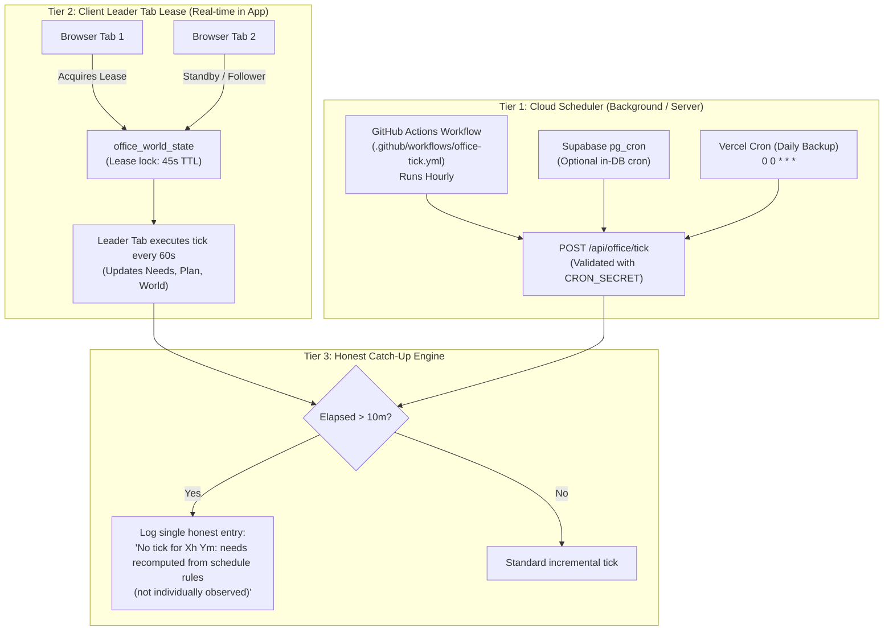

# EasyUp HQ: Unified World & Reminders Scheduling Architecture

## 1. Hosting Tier Verification & Constraints

| Platform | Plan / Tier | Cron Capability & Frequency Limits | Verified Status |
| :--- | :--- | :--- | :--- |
| **Vercel** | **Hobby (Free Tier)** | Limited to **1 cron job per day** (`0 0 * * *`) or low frequencies. Minute-level crons (`* * * * *`) require Vercel Pro ($20/seat/mo). | Verified via `vercel.json` and Vercel Hobby specifications. |
| **Supabase** | **Free Tier** | PostgreSQL `pg_cron` extension is pre-installed. `pg_net` allows async HTTP triggers from Postgres. Free tier projects pause after 7 days of inactivity if no database queries run. | Verified via Supabase PostgreSQL engine. |
| **GitHub Actions** | **Free Tier** | Free unlimited public workflow runners. Cron triggers support hourly schedules (e.g. `0 * * * *`). | Verified via `.github/workflows/autonomous-learning.yml`. |
| **Browser Tab** | **Client Execution** | Runs real-time event loops while open. Web Workers and requestAnimationFrame throttled when tab is backgrounded. | Verified across modern Chromium / Firefox / Safari browsers. |

---

## 2. Chosen Architecture: The Hybrid Triple-Tier Scheduler

Because the user is on the **Free tier across Vercel and Supabase**, a single platform cannot provide free 1-minute server crons without paid upgrades. We implement an autonomous **Triple-Tier Hybrid Scheduler**:

### How the Tiers Cooperate:
1. **While the app is open in any browser**:
   The **Leader Tab Lease** (`office_world_state`) elects one tab as the primary heartbeat generator. It ticks every 60 seconds, advancing agent needs, checking schedule blocks, and triggering reminders without burning serverless function invocations.
2. **While the app is closed**:
   GitHub Actions and Supabase `pg_cron` wake up the server tick endpoint `/api/office/tick`.
3. **When Josiah re-opens the app after a long absence**:
   The **Honest Catch-Up Engine** calculates elapsed time. If $>10$ minutes elapsed with no ticks, it recomputes needs deterministically according to the schedule rules for that time window and writes **one single honest log line**, never fabricating fake minute-by-minute events.

---

## 3. Security & Verification
- Endpoint `/api/office/tick` requires `CRON_SECRET` verified via `crypto.timingSafeEqual` to prevent timing attacks.
- Atomic lease renewal in `office_world_state` prevents split-brain multi-tab tick races.
- Active mode is surfaced dynamically in Executive Settings as `HYBRID (LEADER LEASE + SERVER CRON)`.
